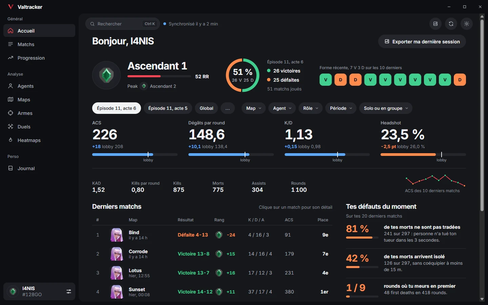
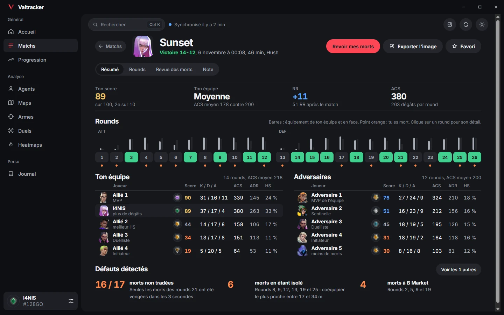
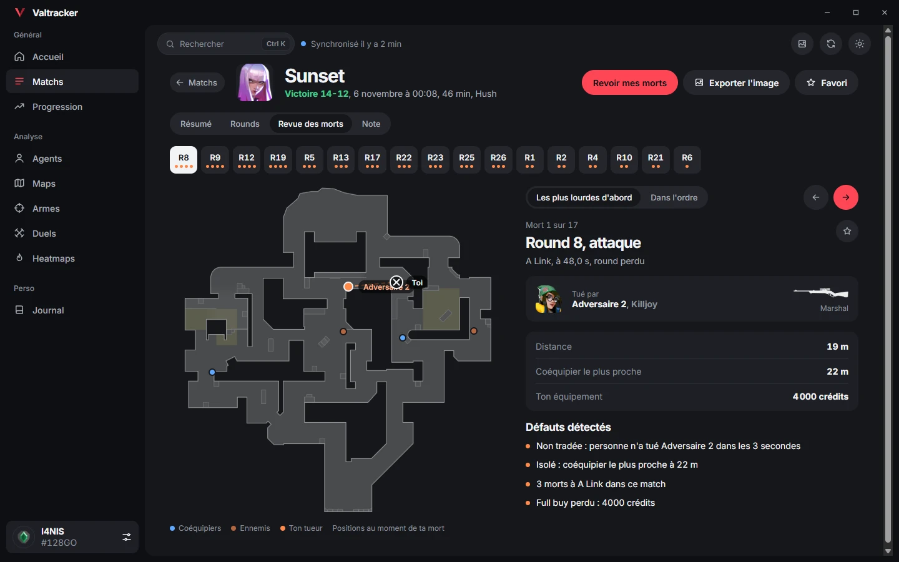
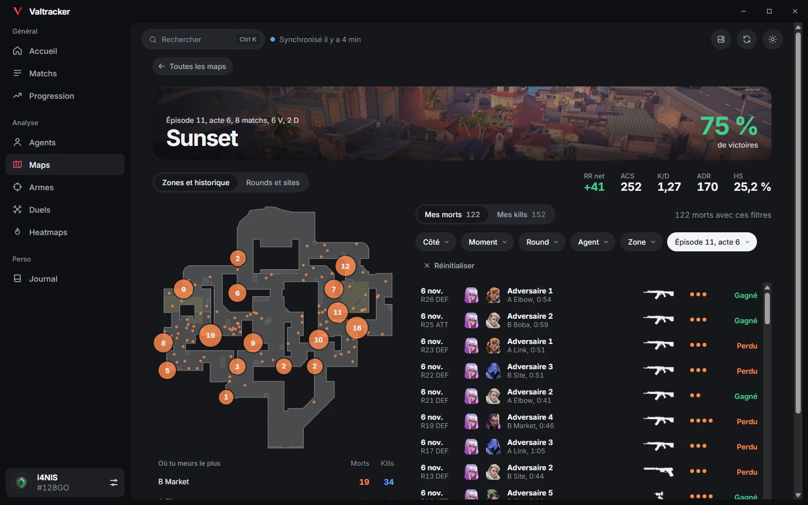
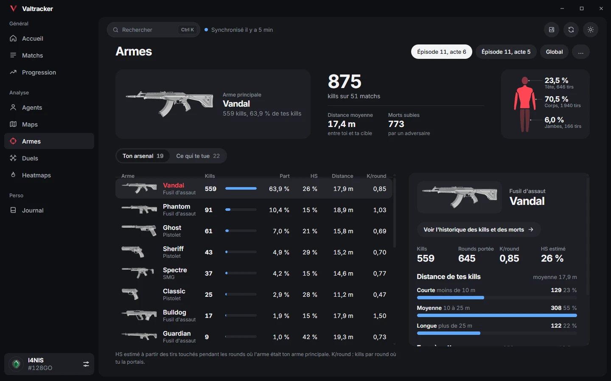
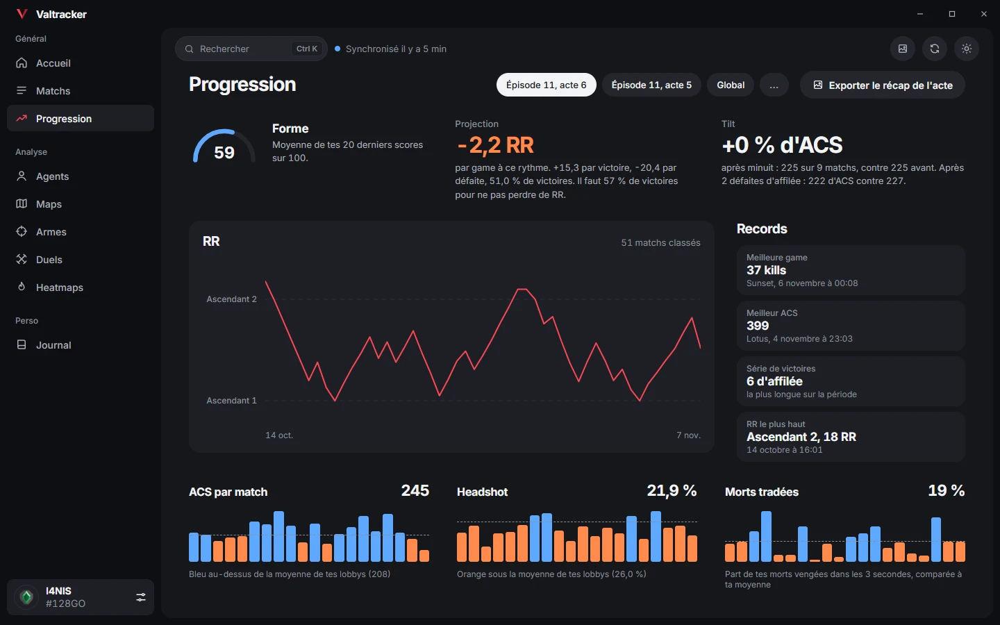
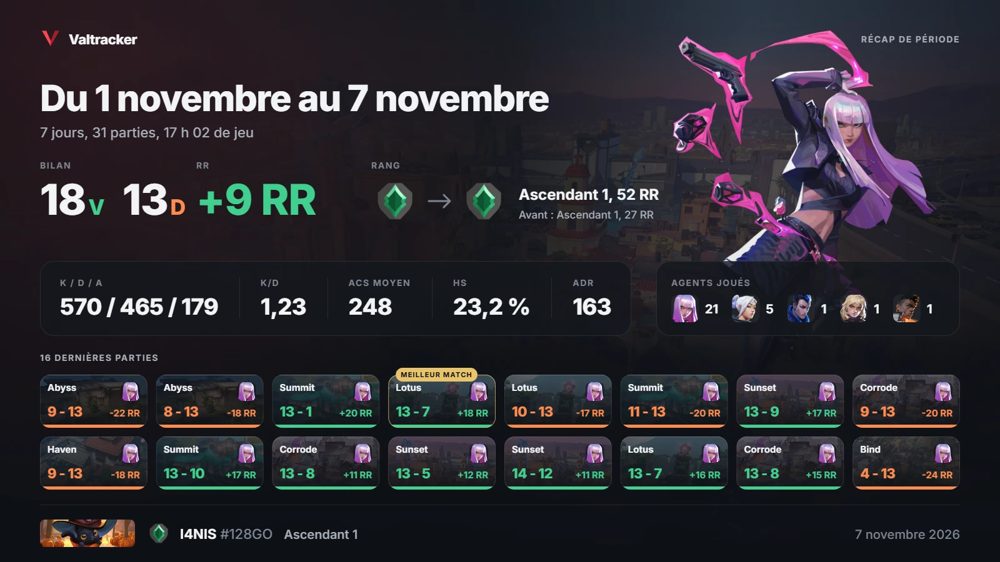

<p align="center">
  
</p>

<h1 align="center">Valtracker</h1>

<p align="center">
  Tes stats Valorant, tes matchs et chacune de tes morts, sur ton PC.
</p>

<p align="center">
  <a href="https://github.com/I4NIS/valtracker/releases/latest/download/Valtracker-setup.exe"></a>
</p>

<p align="center">
  Windows 10 et 11, gratuit.<br>
  <a href="https://i4nis.github.io/valtracker/">Page de téléchargement</a> &nbsp;|&nbsp; <a href="https://github.com/I4NIS/valtracker/releases">Toutes les versions</a>
</p>

<p align="center">
  
</p>

## Chaque match en détail

Score sur 100 pour les 10 joueurs, économie de chaque round et défauts relevés sur tes morts.



## Chaque mort analysée

Chaque mort rejouée sur la minimap, avec la position de tous les joueurs au moment du kill.



## Tes maps en détail

Où tu meurs et où tu tues, zone par zone, avec l'historique de toutes tes morts sur la map.



## Tes armes

Kills, headshots et distance des duels pour chaque arme, et les armes qui te tuent.



## Ta progression

Courbe de RR, forme récente, projection et records de la période.



## Des récaps à partager

Un match, une période, une session ou un acte complet en image 1600×900, copiée en un clic.



## Installation

1. [Télécharge Valtracker](https://github.com/I4NIS/valtracker/releases/latest/download/Valtracker-setup.exe).
2. Lance le fichier. Aucun droit administrateur n'est demandé.
3. Entre ton Riot ID et une clé API HenrikDev, gratuite, à créer sur le [tableau de bord HenrikDev](https://api.henrikdev.xyz/dashboard/).

Les nouvelles versions sont proposées au lancement et s'installent en un clic.

**Avertissement SmartScreen.** L'application n'est pas encore signée, Windows peut afficher un avertissement au premier lancement. Clique sur « Informations complémentaires » puis « Exécuter quand même ».

## Ce que Valtracker ne fait pas

Valtracker ne lit jamais le jeu ni le client Valorant, et ne tourne pas en parallèle de tes parties. Toutes les données viennent de l'API HenrikDev, une fois les matchs terminés. Rien n'est injecté, rien n'est lu en mémoire. Tout reste en local sur ton PC.

## Politique de signature du code

Code signing policy

Free code signing provided by [SignPath.io](https://about.signpath.io), certificate by [SignPath Foundation](https://signpath.org)

L'installateur et l'exécutable sont compilés par GitHub Actions depuis ce dépôt, puis signés. Chaque release est approuvée à la main avant la signature.

| Rôle | Membres |
| --- | --- |
| Auteurs | [I4NIS](https://github.com/I4NIS) |
| Relecteurs | [I4NIS](https://github.com/I4NIS) |
| Approbateurs | [I4NIS](https://github.com/I4NIS) |

### Confidentialité

This program will not transfer any information to other networked systems unless specifically requested by the user or the person installing or operating it.

Valtracker contacte seulement trois services, et seulement pour ce que tu lui demandes :

- l'API HenrikDev, avec ton Riot ID et ta clé API, pour récupérer ton compte et tes matchs ;
- valorant-api.com, pour les images des maps, des agents et des rangs ;
- GitHub, pour vérifier et télécharger les mises à jour.

Aucune statistique d'usage n'est envoyée. Tes données restent dans une base locale sur ton PC.

## Licence

[MIT](LICENSE)

<details>
<summary><strong>Développement</strong></summary>

### Prérequis

- [Node.js](https://nodejs.org/) 20 ou plus récent
- [Rust](https://www.rust-lang.org/tools/install) stable, installé avec rustup
- [Build Tools Visual Studio](https://visualstudio.microsoft.com/visual-cpp-build-tools/) avec « Développement Desktop en C++ »
- WebView2, déjà présent sur Windows 10 et 11

### Lancer et construire

```bash
npm install
npm run tauri dev     # mode développement
npm run tauri build   # installateur dans src-tauri/target/release/bundle/nsis/
```

### Publier une version

Change la version dans `package.json`, commite, puis pousse un tag :

```bash
git tag v0.2.0
git push origin v0.2.0
```

Le workflow GitHub Actions compile et signe l'installateur, puis publie la release avec `Valtracker-setup.exe` et le `latest.json` de la mise à jour automatique. Secrets requis : `TAURI_SIGNING_PRIVATE_KEY`, et `TAURI_SIGNING_PRIVATE_KEY_PASSWORD` si la clé a un mot de passe.

### Architecture

| Dossier | Rôle |
| --- | --- |
| `src/` | Interface en React et TypeScript |
| `src-tauri/` | Cœur en Rust : synchronisation, base SQLite locale, statistiques et analyse des morts |
| `docs/` | Page de téléchargement (GitHub Pages) et captures |

Sources de données : [HenrikDev API](https://docs.henrikdev.xyz) pour les comptes et les matchs, [valorant-api.com](https://valorant-api.com) pour les visuels du jeu.

</details>

## Mentions légales

Valtracker n'est pas approuvé par Riot Games et ne reflète pas les opinions de Riot Games ni de quiconque officiellement impliqué dans la production ou la gestion des propriétés de Riot Games. Riot Games, Valorant et toutes les propriétés associées sont des marques commerciales ou des marques déposées de Riot Games, Inc.
